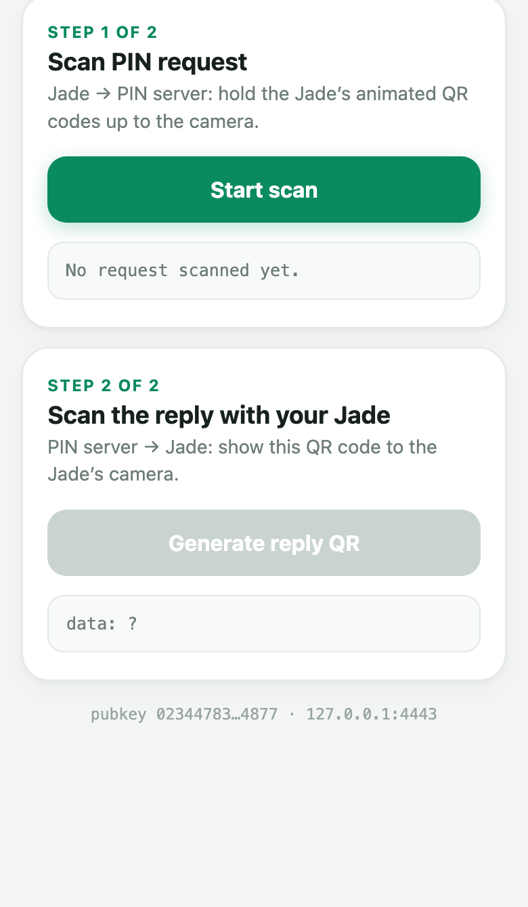
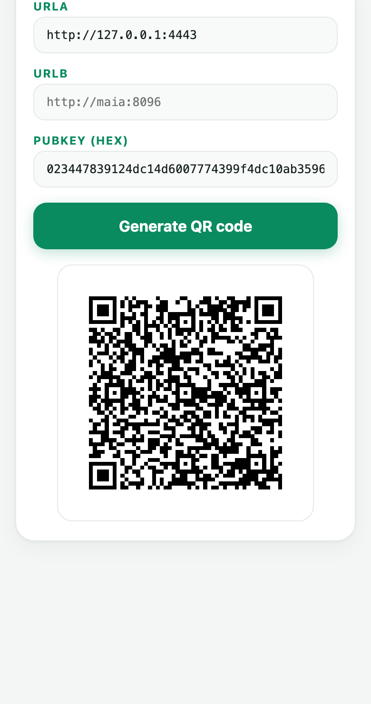
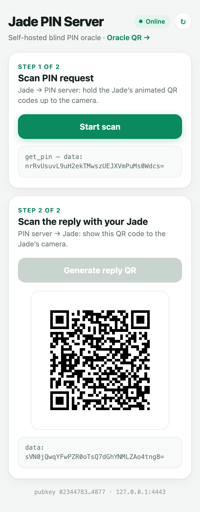

# SimpleJadePinServer (hardened fork)

A simple reimplementation of the [blind_pin_server](https://github.com/Blockstream/blind_pin_server) for the Blockstream Jade hardware wallet, along with a mobile-friendly web interface.

This implementation supports **QR PIN Unlock**, unlike Blockstream's version of the self-hosted blind oracle. This makes it the only self-hosted implementation that allows the Jade hardware wallet to be used in a fully air-gapped way.

This is a hardened fork of [Filiprogrammer/SimpleJadePinServer](https://github.com/Filiprogrammer/SimpleJadePinServer). The oracle protocol is kept byte-compatible with upstream (and with Blockstream's current v2 storage format) — pin files and the static server key are interchangeable.

<p align="center">
  
</p>

> [!NOTE]
> This server requires Jade firmware with support for the shorter two-step blind oracle protocol (firmware ≥ 1.0.28). For the old four-step protocol, see upstream [v1](https://github.com/Filiprogrammer/SimpleJadePinServer/tree/v1).

## Changes in this fork

### Server hardening

- All security checks (pin-file HMAC, anti-replay counter, length checks) are explicit `raise`s instead of `assert`s, so they cannot be stripped by `python -O`. Every error path fails closed with a plain 400 — no key material ever leaves on an error.
- Constant-time comparisons (`hmac.compare_digest`) for the PIN hash and the pin-file HMAC.
- Atomic pin-file writes (tmp file + fsync + `os.replace` + directory fsync). The pin file is rewritten on every unlock; a crash mid-write can no longer corrupt it. The static server key is written the same way on first start, with `0600` permissions.
- `ThreadingHTTPServer` with a 30 s socket timeout and a request-size cap, so a stalled client cannot block unlocks. A global lock keeps all PIN state operations serialized; POST responses carry `Content-Length` and are sent outside the lock.
- Cross-site request hardening: POSTs with a foreign `Origin` header are refused (403). Same-origin browsers and origin-less clients (curl, Blockstream Green, monitoring) are unaffected; extra origins can be allowed via the `ALLOWED_ORIGINS` environment variable.
- In TLS mode the handshake runs in the per-connection thread under the socket timeout (`REQUEST_TIMEOUT`, default 30 s). Previously it ran in the accept loop, where a single client that connected and then stayed silent blocked every other client.
- Key files are checked at start-up: a `private.key` that is not a valid key (empty, truncated) stops the server instead of being replaced; permissions that let other users read it are tightened and reported; a `public.key` that does not belong to the private key is reported. Pin files are written with mode `0600` (existing ones on their next rewrite) and a newly created pins directory with `0700`.
- The number of stored pin files is capped (`MAX_PIN_FILES`, default 1000), so a client that can reach the port cannot fill the disk with pin records. Wallets that already have a record are never affected by the cap. If the cap is ever reached, new wallets are refused until pin files are removed from `key_data/pins/` — each file is named after its wallet, and the first eight characters are the wallet id shown in the `New pin stored [wallet …]` log lines, so the records to keep can be told apart from the rest.
- Every log line is written in one piece under a lock to standard output — the server's event lines and the access lines of the HTTP library alike. Access lines start with the client address and are cut to a fixed length. Lines of concurrent requests therefore cannot run into each other, and an event line cannot be hidden from a log watcher by flooding the server with other requests.
- Every response carries a strict `Content-Security-Policy` (own scripts only, no inline script, no framing) and the usual hardening headers; the `Server` header no longer reveals the Python version. Only the listed web assets are served, loaded once at start-up.

### Web interface

- Mobile-friendly rework: proper viewport, card layout, constrained camera view (no more full-width video on phones), fragment progress display, reload button for standalone/home-screen use, favicon and apple-touch-icon.
- The BC-UR decoder verifies both the per-fragment bytewords CRC32 and the reassembled message CRC32 — a mis-scan or mixed-up fragment set is rejected with a visible error instead of silently producing a corrupt request. Broken 32/64-bit reads in the CBOR decoder are fixed.
- Scanned QR data is rendered with `textContent` (no HTML injection), request bodies are built with `JSON.stringify`, and the step-2 button guards against double submission.
- Unlocking takes one tap: **Start scan** opens the rear camera directly, and a scanned unlock request (`get_pin`) is sent to the server automatically. A new-PIN request (`set_pin`) still waits for an explicit tap, because it replaces what the server stores for that wallet. The screen is kept awake while scanning and while the reply is shown (where the browser supports it). A request is never sent twice: if the same request is scanned again while the Jade still shows it, the page waits for the answer that is already on its way, or shows the answer it already has.
- Nothing fails silently: a rejected request, an unreachable server or a camera that cannot be started is explained in the page, together with what to do next (a PIN request works only once — after a rejection the Jade has to produce a new one).
- The BC-UR/CBOR code lives in one file (`jade-codec.js`) shared by both pages and is covered by its own test (`test_codec.js`).

### Supply chain

- All dependencies ship with the repository: `wallycore` is installed from `requirements.txt` with pinned SHA-256 hashes (`--require-hashes`; the pin covers every official PyPI artifact of the release and only changes deliberately), and both JavaScript libraries are vendored — `html5-qrcode` sha512-verified against the original SRI hash.
- Nothing is loaded from a CDN and the server needs no network access at runtime; the interface works fully offline.
- The Docker base image is pinned by digest; the Dockerfile says how to move the pin to a newer image.
- The Docker Compose setup binds the container port to loopback only and runs the container with a read-only root filesystem, without Linux capabilities, with `no-new-privileges` and with process and memory limits.

### Deliberately unchanged (upstream parity)

`set_pin` persists the client's replay counter (so a captured `set_pin` request cannot be replayed) and only a missing (not corrupt) pin file allows re-registration — both match Blockstream's reference implementation exactly and are pinned by the test suite.

## Running the server

### With Docker Compose (recommended)

```console
docker compose up -d
```

The web interface will be available at http://127.0.0.1:18080 — the container port is bound to loopback only, so nothing is exposed to the network by default. Keys and pin records are stored in the bind-mounted `key_data/` directory.

The container runs as root but without any Linux capability, so it cannot bypass file permissions: `key_data/` has to belong to root. That is the case when Docker creates the directory on first start; if you created it yourself as another user, run `sudo chown -R root:root key_data` once. The pages cannot be embedded in other pages (`X-Frame-Options: DENY`); open them directly.

> [!TIP]
> Docker Compose starts the server without TLS — put a reverse proxy (Caddy, NGINX, Tailscale serve, …) in front if you need to reach it from a non-localhost address. Browsers require a secure context (HTTPS or localhost) for camera access.

### Manual (Python)

```console
apt update
apt install python3 python3-pip python3-venv
python3 -m venv venv
source venv/bin/activate
pip install --require-hashes -r requirements.txt
python3 SimpleJadePinServer.py --no-tls
```

The web interface will be available at http://127.0.0.1:4443. On first run, a static server key pair is generated in `key_data/server_keys/`. Without `--no-tls` the server expects a TLS certificate at `key_data/server.pem` (see next section) and exits if none is present.

### TLS certificate (manual mode)

For camera access from non-localhost connections the interface must be served over HTTPS. Either terminate TLS in a reverse proxy, or give the server a certificate at `key_data/server.pem`:

```console
mkdir key_data
cd key_data
openssl req -new -x509 -keyout server.pem -out server.pem -days 3650 -nodes
cd ..
```

> [!IMPORTANT]
> Back up `key_data/` (the static server key and the pin records). Losing the server key means the Jade can only be recovered with the seed phrase.

## Pointing the Jade to the pin server

Click the **Oracle QR** link in the web interface (or open `/oracle_qr.html`) and click **Generate QR code**.

<p align="center">
  
</p>

Power on the Jade and access the boot menu by clicking (not holding) the select button once while the logo appears.

> [!IMPORTANT]
> The Jade needs to be uninitialized in order to set a new blind oracle. If your Jade is already set up, you will need to perform a factory reset and **restore using your recovery phrase, as your wallet will be deleted. Your funds will be lost if you do not have the correct backup materials.**
>
> Source: https://help.blockstream.com/hc/en-us/articles/12800132096793-Set-up-a-personal-blind-oracle


Select "Blind Oracle" and then "Scan Oracle QR".


Scan the generated QR code and confirm the details on screen.


> [!NOTE]
> If the Jade is used only in QR mode, it does not matter where the URL points to, making the public key of the pin server the only important parameter.
>
> However, firmware upgrades on an initialized Jade require the wallet to be unlocked over USB or Bluetooth, so the URL must be correct and reachable during that process. This requirement does not apply to the Jade Plus, since it supports air-gapped firmware upgrades via external USB storage.
>
> Alternatively, one can always factory-reset the Jade, apply the firmware upgrade, and then re-initialize it afterwards.

<details>
<summary>Alternative setup via USB</summary>

An alternate way of pointing the Jade to a custom pin server is via a USB connection to a computer using the `set_jade_pinserver.py` script in the Jade repository.

```console
git clone https://github.com/Blockstream/Jade
cd Jade
python3 set_jade_pinserver.py --serialport <ENTERJADESERIALPORT> --set-pubkey path/to/SimpleJadePinServer/key_data/server_keys/public.key --set-url http://127.0.0.1:4443
```

Point `--set-url` at wherever your server is actually reachable — e.g. `https://…:4443` when TLS is enabled, or `http://127.0.0.1:18080` for the Docker Compose setup.
</details>

## Unlocking in QR mode

Once the Jade is configured, initialize the wallet and choose **QR** when asked to select a connection. For later unlocks, select "QR Mode" → "QR PIN Unlock" on the Jade.

### Step 1 — scan the PIN request

After you enter the PIN, the Jade displays a series of animated BC-UR QR codes. Click **Start scan** in the web interface (the rear camera opens directly; allow camera access when the browser asks) and hold the Jade in front of the camera. The scan completes automatically once all fragments are captured; a mis-scan is reported and scanning simply continues.

### Step 2 — show the reply to the Jade

For an unlock the request is sent to the server as soon as the scan is complete, and the interface displays the reply as an animated QR code; continue to Step 2/2 on the Jade and scan it. When you set a new PIN, click **Generate reply QR** first — a new PIN replaces what the server stores for the wallet, so it is never sent without that click.

If the server rejects a request, the page says so. A PIN request can be used only once: go back on the Jade, start the unlock again and scan the new QR codes.

<p align="center">
  
</p>


Once scanning is complete, the wallet unlocks.

## Using USB or BLE mode

Once the Jade has its blind oracle configured, simply use the Jade with Blockstream Green as normal. Green might complain the first time that a non-default blind oracle is being used.


This can be dismissed by clicking "Advanced", enabling "Don't ask me again for this oracle" and clicking "Allow Non-Default Connection".


## Testing

`test_protocol.py` is an end-to-end suite (37 checks; one of them needs a non-root user and is skipped otherwise, e.g. in the Docker image) that plays the client half of the blind-oracle protocol with the same wally primitives: set/get roundtrip, replay rejection (including after failed attempts), wrong-PIN counter and reset, two wrong attempts do not wipe, three-strikes wipe, wallet isolation, blind semantics after the wipe and for unknown wallets, restart persistence without key regeneration, corrupt-pin-file handling, origin checks, malformed and oversized requests, the exact format of the security event lines and their resistance to log injection, the start-up checks (missing key or pins directory, loose permissions, key mismatch, invalid key, unusable settings or certificate), the pin file limit, intact event lines under concurrent load, the security headers and asset handling, and TLS mode with silent and non-TLS clients.

Run it against a throwaway container — never against real `key_data`:

```console
docker compose build
docker run --rm -v ./test_protocol.py:/app/test_protocol.py:ro \
  --entrypoint python3 <image-name> /app/test_protocol.py
```

`test_codec.js` tests the QR transport code of the web pages (`jade-codec.js`) against the official Bytewords/UR test vectors and against an independent encoder written from the specifications: decoding of Jade-style requests in one or many fragments, rejection of damaged scans, and the encoding of the reply and Oracle QR codes. It needs only Node.js:

```console
node test_codec.js
```

`test_browser.js` (optional, needs [Playwright](https://playwright.dev) and a Python with `wallycore`) drives the real pages in a browser: a simulated Jade shows its request as QR codes through a fake camera, the page scans them and talks to a server instance the test starts with throwaway keys, and the simulated Jade decrypts the reply shown as QR codes. It covers the one-tap unlock, an already used request, an unreachable server, a proxy error, a damaged scan, a scan stopped by hand, a new scan while an answer is pending, the same request scanned twice, switching cameras, the new-PIN confirmation, the Oracle QR page, and fails on any Content-Security-Policy violation:

```console
PYTHON=venv/bin/python node test_browser.js            # Chromium, full flow
PYTHON=venv/bin/python node test_browser.js webkit     # page checks without a camera
```

## Security notes

This fork is built for a **private, single-user deployment** behind a VPN (e.g. a tailnet) with TLS termination in front. It is not designed to be exposed to the public internet: `set_pin` is unauthenticated by protocol design (anyone who can reach the port can create pin records), and the only brute-force protection for a given wallet is the three-strikes wipe.

The server never learns your PIN or your wallet secrets — it is a blind oracle. What it stores per wallet is a 129-byte encrypted record; what it must keep secret is the static server key in `key_data/server_keys/`.

The server writes one plain event line per security-relevant action — `New pin stored [wallet …]`, `Correct pin on the N. attempt [wallet …]`, `Wrong pin (N. attempt) [wallet …]`, `Too many wrong attempts [wallet …]`, `Replay rejected [wallet …]` (a request that was already used), `Pin file damaged [wallet …]` (the stored record failed its integrity check), `Unknown wallet [wallet …]` (an unlock request for a wallet without a record; it is answered with a junk key, which the Jade counts as a failed attempt) and `Pin limit reached [wallet …]`, plus at start-up `Static server public key: …`, `WARNING: NEW STATIC SERVER KEY GENERATED`, `WARNING: PUBLIC KEY MISMATCH`, `NOTICE: pins directory missing` and `NOTICE: private.key was accessible to other users`. These lines always start a log line and contain no request-controlled text (the rejected `Origin` value is sanitised before logging), so an external watcher can anchor on them (`^` after the log timestamp) without being spoofable through headers or request paths. The wallet id is the first 8 hex characters of the pin file name and is not secret.

The `Origin` check is a same-origin/CSRF guard, not a DNS-rebinding defense — in the recommended deployment (TLS-terminating proxy) certificate validation is what defeats rebinding. Error responses are deliberately diagnosable (HTTP 400) where Blockstream's server always replies with a junk key; an attacker replaying a previously captured valid request could at most learn whether a wallet record still exists.

## Disclaimer

This software guards access to a hardware wallet. It is provided *as is*, without warranty of any kind — see [LICENSE](LICENSE). Review the code yourself before trusting it with anything of value, keep your recovery phrase backed up, and remember that losing the static server key in `key_data/` means your Jade can only be restored from seed.

The modifications in this fork were developed exclusively by AI — Anthropic's Claude, models **Claude Fable 5.1** and **Claude Fable 5.2** — directed by a human operator. The changes were verified against Blockstream's reference implementation by AI, are covered by the test suites described above, and went through multiple independent AI review passes with fresh context — but no amount of testing replaces your own review. This is a hobby project, not a professionally audited product.

## License

MIT — see [LICENSE](LICENSE). Original work © Filiprogrammer, fork modifications © hobbesd. Bundled third-party components: qrcode.js (MIT, Kazuhiko Arase) and html5-qrcode (Apache-2.0, full text in [LICENSES/Apache-2.0.txt](LICENSES/Apache-2.0.txt)).

---

*This project is an independent, community-developed reimplementation. It is not affiliated with, endorsed, or supported by Blockstream. "Blockstream", "Jade" and "Green" are trademarks of Blockstream Corporation Inc. "QR Code" is a registered trademark of DENSO WAVE Incorporated.*
